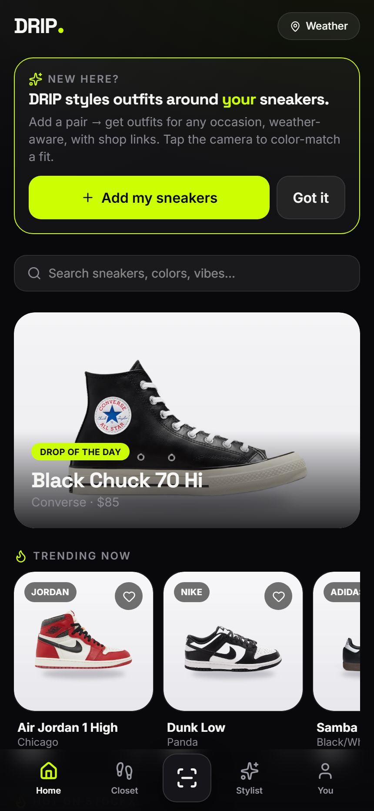
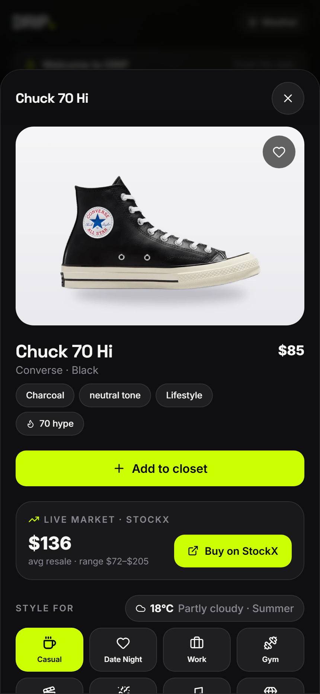
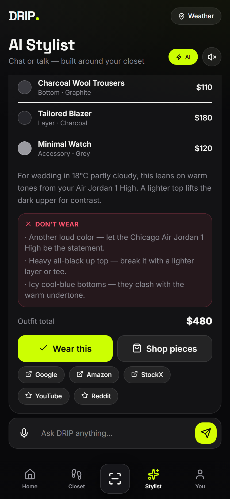
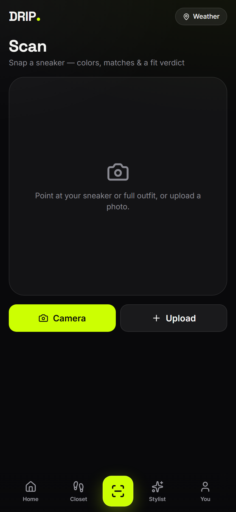

<div align="center">

# DRIP — AI Sneaker Stylist

### Build outfits around your sneakers. Real AI. Real market data. Real community.

[**▶ Live app**](https://drip-two-rho.vercel.app) · Installable PWA · Mobile-first


</div>

<p align="center">
  
  
  
  
</p>

---

## What it is

**DRIP** is an AI styling companion that builds outfits around *your* sneaker collection — "Nike SNKRS meets a personal stylist AI." It pairs a real-time sneaker database, a genuine recommendation engine, computer-vision color scanning, and a **multi-agent LLM stylist** into a fast, installable PWA.

## Features

- 🤖 **Multi-agent AI stylist** — a Stylist agent drafts a fit, a Critic agent refines it. Multi-turn memory, weather/occasion aware, comments on your exact pieces. (NVIDIA → OpenRouter → HuggingFace fallback chain.)
- 💰 **Live market data** — real StockX resale prices, ranges and buy links per shoe (via KicksDB). The catalog search hits the **entire StockX database**, not a static list.
- 📸 **Camera color scan** — k-means dominant-color extraction (Canvas API), auto-captures when you hold a shoe steady, AI-written fit verdict, nearest-match against your closet.
- 🧠 **Recommendation engine** — content-based feature vectors + a taste profile learned from your likes/views/wears + MMR diversity. A real "For You" feed that adapts as you browse.
- 🌦️ **Weather-aware outfit engine** — color theory (harmony / contrast / temperature) × 12 occasions × gender & modest styling × live weather (Open-Meteo).
- 🔥 **Live community feed** — real r/Sneakers posts (Reddit OAuth), YouTube reviews, and sneaker-news drops, merged and de-duped.
- 👟 **Closet + rotation** — wear tracking, "wear next" nudges, a saved-fit **Lookbook**, daily streak.
- 🎙️ **Voice** — talk to the stylist (Web Speech API) with a live mic waveform.
- 💸 **Multi-currency** shop, budget filter, real shop/review links, daily streaks, style quiz & Style DNA.

## Architecture

```
React 19 + Vite 8 + Tailwind v4  (mobile-first PWA, offline service worker)
  ├─ Zustand store           closet · likes · interactions · lookbook (localStorage)
  ├─ lib/recsys              feature vectors · taste profile · MMR · personalized search
  ├─ lib/outfitEngine        color theory · occasion · weather · gender/modest
  ├─ lib/color               k-means palette · WCAG luminance · harmony
  └─ Vercel serverless fns
       ├─ /api/stylist       multi-agent LLM (NVIDIA/OpenRouter/HF) + rate-limit + memory
       ├─ /api/sneakers      live StockX price/image/buy-link (KicksDB)
       ├─ /api/search        full live catalog search (KicksDB, footwear-only)
       └─ /api/feed          Reddit + YouTube + sneaker-news, image-only, edge-cached
```

Every integration **fails soft** — the app is fully functional with zero API keys (curated catalog, local stylist brain, RSS feed); keys progressively light up live AI + live data.

## Run locally

```bash
npm install
npm run dev          # http://localhost:5173
npm run build        # production build → dist/
```

Optional API keys (all free tiers) unlock live AI + data — see [`.env.example`](.env.example). Set them in Vercel → Settings → Environment Variables.

## Tech

`React 19` · `Vite 8` · `Tailwind v4` · `Zustand` · `vite-plugin-pwa` · `Web Speech / Web Audio / Canvas` · `Open-Meteo` · `KicksDB (StockX)` · `OpenRouter · NVIDIA NIM · HuggingFace` · `Reddit · YouTube` · `Vercel serverless`

---

<div align="center">
Built by <b>Vaibhav Lalwani</b> · <a href="https://drip-two-rho.vercel.app">drip-two-rho.vercel.app</a>
</div>
